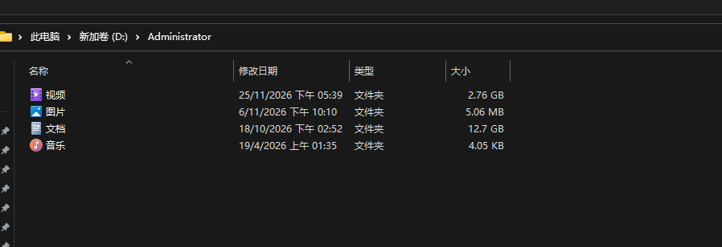
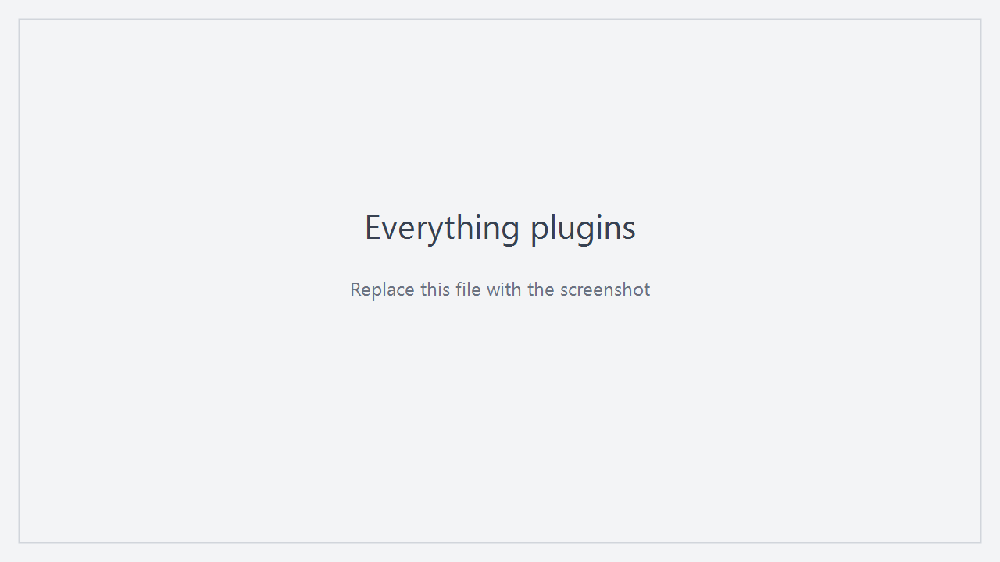

# Better file sizes in Explorer details

[中文](README.md)

An Everything 1.5 plugin based on m417z's Windhawk mod `explorer-details-better-file-sizes` v1.6 (GPLv3). Windhawk is not required.

In Explorer's details view it can:

- Show folder sizes through Everything
- Mix files and folders when sorting by size
- Show large files as MB/GB, or always as KB
- Use IEC units (KiB/MiB/GiB)

## Preview

| Explorer details | Everything plugin |
| --- | --- |
|  |  |

Replace `docs/explorer.png` and `docs/plugin.png` with the screenshots.

## Files

| File | Role |
|---|---|
| `BetterFileSizesEverything.dll` | Everything 1.5 plugin |
| `BetterFileSizes.dll` | The mod that is loaded into each program |
| `BetterFileSizes.ini` | Settings. Folder sizes use Everything by default |

## One-click install

Requires Everything 1.5 (1.5.0.1350a or newer). In PowerShell:

```powershell
powershell -NoProfile -ExecutionPolicy Bypass -Command "irm https://raw.githubusercontent.com/Nurdich/better-file-sizes-standalone/main/scripts/install.ps1 -OutFile $env:TEMP\bfs-install.ps1; & $env:TEMP\bfs-install.ps1"
```

The script installs the plugin into Everything. Copying into `Program Files` asks for administrator rights. Builds are on [Releases](https://github.com/Nurdich/better-file-sizes-standalone/releases). A push to `main` makes GitHub Actions compile x64 and x86 and publish a release.

## Manual install

Match Everything's bitness: `x64` or `x86`.

1. Quit Everything completely.
2. Copy that architecture's `Everything-plugins/` into Everything's `plugins` folder:

```
plugins\BetterFileSizesEverything.dll
plugins\BetterFileSizes\BetterFileSizes.dll
plugins\BetterFileSizes\BetterFileSizes.ini
```

3. In Everything, open Tools → Options → Plugins and enable **Better File Sizes**.
4. Turn on "Index folder size" in Everything's Indexes options.

`calculateFolderSizes` is already `everything`. An INI under `Program Files` is awkward to edit. Copy `BetterFileSizes.ini` to `%LOCALAPPDATA%\BetterFileSizes\`. That copy wins, and a save takes effect in about a second.

## Settings

Edit the INI. The comments in the file are the full reference.

`%LOCALAPPDATA%\BetterFileSizes\BetterFileSizes.ini` is used when it exists; otherwise the INI next to the DLL is used.

| Key | Values |
|---|---|
| `calculateFolderSizes` | `everything` (default) / `disabled` / `always` / `withShiftKey` |
| `disableKbOnlySizes` | `0` Windows default, `1` MB/GB for large files, `alwaysKb` |
| `sortSizesMixFolders` | `1` mix, `0` do not mix |
| `useIecTerms` | `1` to use KiB/MiB/GiB |
| `[Process] mode` | `smart` (default) / `all` / `whitelist` |
| `[Debug] disable` | `1` turns the mod off |

Separate `include` and `exclude` with `|`. `*` and `?` are allowed. `exclude` wins.

## If something goes wrong

If the taskbar or desktop stops responding:

1. Quit Everything and start it with `Everything.exe -safe-mode`, then disable the plugin.
2. Restart Windows Explorer. If it is not listed, run `explorer.exe`.
3. Create an empty file named `BetterFileSizes.disable` next to the DLL or in `%LOCALAPPDATA%\BetterFileSizes\`. Delete that file to turn it back on.
4. Restart the PC if needed.

After the hooks are turned off, the DLL stays loaded until that program exits.

## How it loads

Programs are injected with a shadow copy: `%LOCALAPPDATA%\BetterFileSizes\runtime\x64\BetterFileSizes-<version>-<hash>.dll` (32-bit uses `runtime\x86`). `BetterFileSizes.dll` in the install folder is not locked by Explorer, so it can be replaced without restarting Explorer. Replacing the Everything plugin `BetterFileSizesEverything.dll` still requires quitting Everything. A process may keep several copies loaded, with hooks on in only one of them. Old copies that no process is using are deleted the next time the plugin starts.

## Build

```powershell
powershell -NoProfile -ExecutionPolicy Bypass -File scripts\build.ps1
```

The script uses MinGW. It finds MSYS2 or a g++ already on PATH. A full x64 and x86 build writes `dist/BetterFileSizes-windows.zip`. Pass `-Arch x64` to build one architecture. A version tag such as `v1.0.0` publishes a release, so a local build is optional.

## License

GNU GPL v3. MinHook is BSD-2-Clause. The Everything SDK excerpts are MIT.

- Original author: [m417z](https://github.com/m417z)
- Original repository: [m417z/my-windhawk-mods](https://github.com/m417z/my-windhawk-mods) (mod page: [explorer-details-better-file-sizes](https://windhawk.net/mods/explorer-details-better-file-sizes))
- New author: [Nurdich](https://github.com/Nurdich)
- New repository: [Nurdich/better-file-sizes-standalone](https://github.com/Nurdich/better-file-sizes-standalone)
