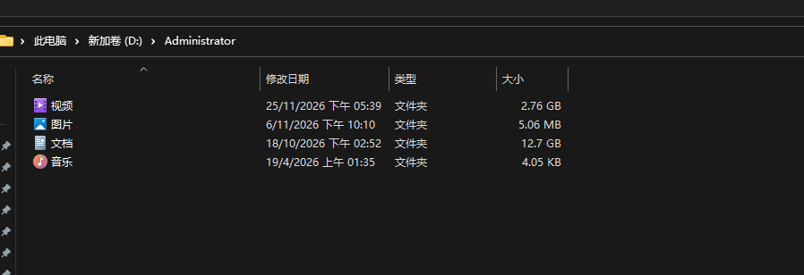
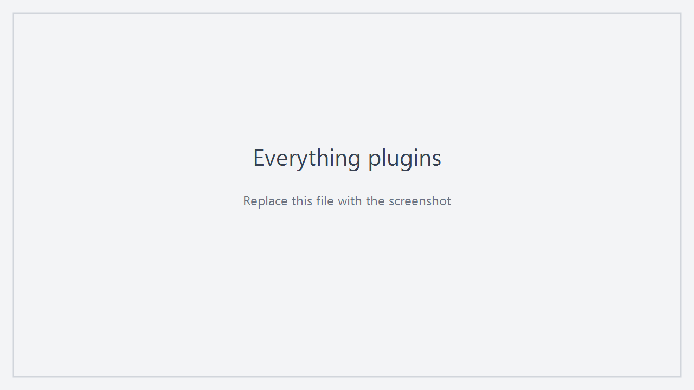

# Better file sizes in Explorer details

[English](README.en.md)

Everything 1.5 插件。不安装 Windhawk。基于 m417z 的模组 `explorer-details-better-file-sizes` v1.6（GPLv3）。

资源管理器「详细信息」里可以：

- 通过 Everything 显示文件夹大小
- 按大小排序时，文件和文件夹混在一起排
- 大文件显示成 MB/GB，或始终用 KB
- 改用 KiB/MiB/GiB

## 效果

| 资源管理器「详细信息」 | Everything 插件 |
| --- | --- |
|  |  |

截好后直接覆盖这两个文件：`docs/explorer.png`、`docs/plugin.png`。

## 文件

| 文件 | 作用 |
|---|---|
| `BetterFileSizesEverything.dll` | Everything 1.5 插件 |
| `BetterFileSizes.dll` | 真正生效的模组，会加载进各个程序 |
| `BetterFileSizes.ini` | 设置。文件夹大小默认走 Everything |

## 一键安装

需要 Everything 1.5（1.5.0.1350a 及以后）。在 PowerShell 里执行：

```powershell
powershell -NoProfile -ExecutionPolicy Bypass -Command "irm https://raw.githubusercontent.com/Nurdich/better-file-sizes-standalone/main/scripts/install.ps1 -OutFile $env:TEMP\bfs-install.ps1; & $env:TEMP\bfs-install.ps1"
```

脚本会把插件装进 Everything。装到 `Program Files` 时会要求管理员权限。发布包在 [Releases](https://github.com/Nurdich/better-file-sizes-standalone/releases)。推送到 `main` 后，GitHub Actions 会自动编译 x64 / x86 并发布。

## 手动安装

位数要和 Everything 一致：64 位用 `x64`，32 位用 `x86`。

1. 完全退出 Everything。
2. 把对应位数的 `Everything-plugins/` 复制到 Everything 的 `plugins` 目录，结果是：

```
plugins\BetterFileSizesEverything.dll
plugins\BetterFileSizes\BetterFileSizes.dll
plugins\BetterFileSizes\BetterFileSizes.ini
```

3. 打开 Everything → 工具 → 选项 → 插件，启用 **Better File Sizes**。
4. 在 Everything 的索引选项里勾选「索引文件夹大小」。

`calculateFolderSizes` 默认就是 `everything`。`Program Files` 里的 INI 不好改。把 `BetterFileSizes.ini` 复制到 `%LOCALAPPDATA%\BetterFileSizes\`，以后只改这一份。保存后大约 1 秒生效。

## 设置

直接改 INI。文件里的注释就是完整说明。

优先读 `%LOCALAPPDATA%\BetterFileSizes\BetterFileSizes.ini`，没有再读 DLL 旁边那份。

| 键 | 取值 |
|---|---|
| `calculateFolderSizes` | `everything`（默认）/ `disabled` / `always` / `withShiftKey` |
| `disableKbOnlySizes` | `0` 系统默认，`1` 大文件用 MB/GB，`alwaysKb` 始终 KB |
| `sortSizesMixFolders` | `1` 混排，`0` 不混排 |
| `useIecTerms` | `1` 用 KiB/MiB/GiB |
| `[Process] mode` | `smart`（默认）/ `all` / `whitelist` |
| `[Debug] disable` | `1` 时全部停用 |

`include` 和 `exclude` 用 `|` 分开，可以用 `*` 和 `?`。`exclude` 优先。

## 出问题

任务栏或桌面没反应时：

1. 完全退出 Everything。再用 `Everything.exe -safe-mode` 启动，到插件页里取消启用。
2. 重启「Windows 资源管理器」。没有这一项就运行 `explorer.exe`。
3. 在 DLL 所在目录，或 `%LOCALAPPDATA%\BetterFileSizes\`，新建一个空文件 `BetterFileSizes.disable`。删掉这个文件就恢复。
4. 还不行就重启电脑。

钩子关掉后，DLL 会留在那个程序里，直到程序自己退出。

## 加载

注入进各程序的是影子副本：`%LOCALAPPDATA%\BetterFileSizes\runtime\x64\BetterFileSizes-<版本>-<哈希>.dll`（32 位是 `runtime\x86`）。安装目录里的 `BetterFileSizes.dll` 不会被资源管理器锁住，覆盖它不必结束资源管理器。替换 Everything 插件 `BetterFileSizesEverything.dll` 仍要先退出 Everything。同一个进程里可以有多份副本，但只有一份钩子是开着的。没有进程再用的旧副本，会在下次启动插件时删掉。

## 编译

```powershell
powershell -NoProfile -ExecutionPolicy Bypass -File scripts\build.ps1
```

脚本使用 MinGW。本机有 MSYS2 或把 g++ 放在 PATH 上即可。x64 和 x86 都编完后，安装包在 `dist/BetterFileSizes-windows.zip`。只要一种位数：`-Arch x64`。打上 `v1.0.0` 这样的版本标签后，Actions 会发布。

## 许可

GNU GPL v3。MinHook 为 BSD-2-Clause，Everything SDK 片段为 MIT。

- 原作者：[m417z](https://github.com/m417z)
- 原仓库：[m417z/my-windhawk-mods](https://github.com/m417z/my-windhawk-mods)（模组页：[explorer-details-better-file-sizes](https://windhawk.net/mods/explorer-details-better-file-sizes)）
- 新作者：[Nurdich](https://github.com/Nurdich)
- 新仓库：[Nurdich/better-file-sizes-standalone](https://github.com/Nurdich/better-file-sizes-standalone)
